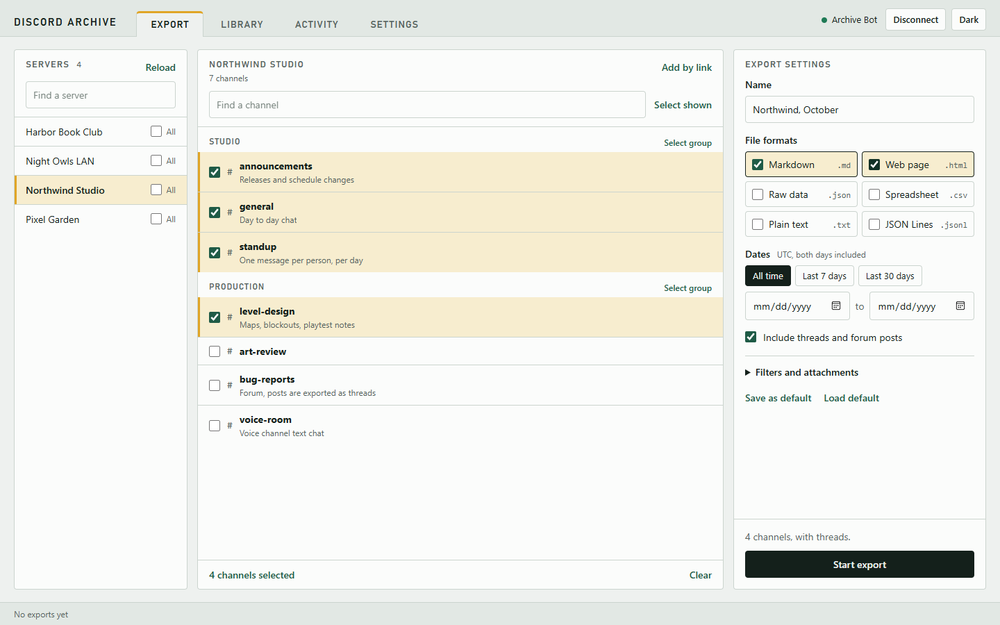
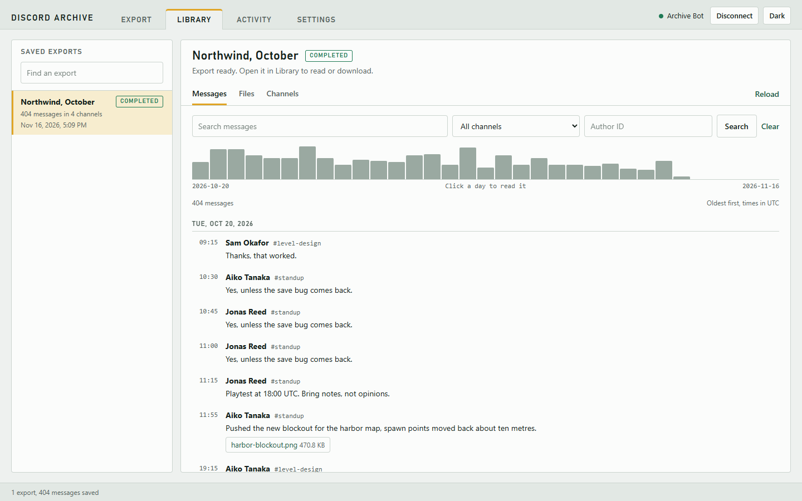

# Discord Archive

Saves Discord channels to files on your own computer, and gives you a page in the browser to read and search what was saved. It works through a bot you add to the server.



## What it does

- Exports single channels or a whole server, with threads and forum posts.
- Writes Markdown, HTML, JSON, JSON Lines, CSV or plain text. Pick one or several.
- Filters by date range, author, text, or pinned messages only.
- Can download attachments, with a size limit per file and in total.
- Saves progress as it goes, so an export can be paused and resumed later.
- Keeps every export in a local library you can search by text, channel, author and day.



## Requirements

Python 3.10 or newer. There is nothing else to install.

## Bot setup

1. Create an application in the [Discord Developer Portal](https://discord.com/developers/applications) and add a bot to it.
2. On the Bot page, turn on Message Content Intent and copy the token.
3. Invite the bot to your server with the View Channels and Read Message History permissions.

## Running it

On Windows, double-click `Start.cmd`. On any system:

```
python app.py
```

The app opens in your browser. Paste the bot token, pick a server and channels, then start the export. Keep the terminal window open while it runs.

To stop it, use `Stop.cmd`, Settings > Quit app, or Ctrl+C in the terminal. Closing the browser tab does not stop it.

Options:

```
python app.py --port 8765       use a fixed port
python app.py --no-browser      do not open the browser
python app.py --data D:\archive keep the library somewhere else
```

## Where the files go

- `exports/` holds one folder per export with the files you asked for and a `manifest.json` report.
- `data/` holds the SQLite library used for search and for resuming.

Both are created next to the app the first time it runs. They are plain files and are not encrypted.

The token is only kept in memory. It is never written to disk and is cleared when you disconnect or quit.

## Limits

- Only messages the bot can read are exported. An empty result can mean the bot is missing Read Message History in that channel.
- Deleted messages, ephemeral replies and voice audio cannot be exported.
- The end of the date range is fixed when an export starts. Run a new export to pick up newer messages.
- Attachment links from Discord expire. Turn on attachment downloads if you need the files to last.

## Layout

```
app.py            local web server and JSON API
core/api.py       Discord client, rate limits and retries
core/engine.py    job queue, channel discovery, paging, attachments
core/formats.py   file writers for each export format
core/store.py     SQLite library
core/instance.py  single-instance lock
core/lifecycle.py Stop.cmd support on Windows
web/              the page: index.html, app.js, style.css
```

The server only listens on 127.0.0.1 and checks a session key on every request.

## License

MIT, see [LICENSE](LICENSE).

Haider Alowlaqi, aka King Specter · ceo@specters.group · haider.alowlaqi@gmail.com · Discord: 9king
